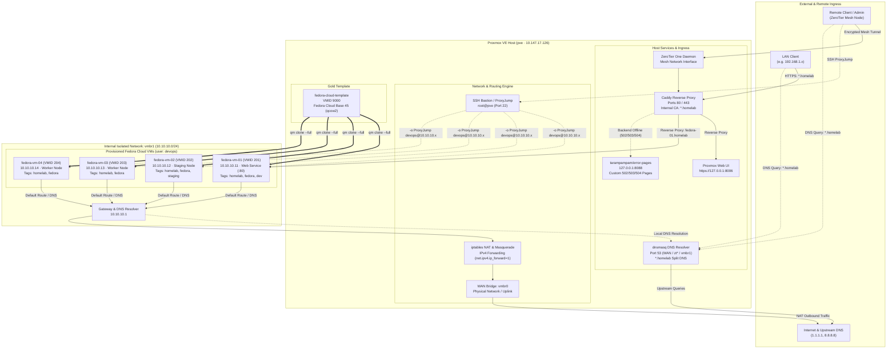
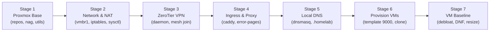

# Homelab Infrastructure as Code (Ansible & Proxmox VE)

[](https://www.ansible.com/)
[](https://www.proxmox.com/)
[](https://fedoraproject.org/)
[](https://caddyserver.com/)
[](https://www.zerotier.com/)

Declarative, fully automated Infrastructure-as-Code (IaC) framework for **Proxmox Virtual Environment (PVE)** powered by **Ansible**.

This project bootstraps a hardened Proxmox hypervisor, creates an isolated internal routed network (`vmbr1`) with NAT masquerading, configures a split-horizon local DNS server, sets up a ZeroTier mesh VPN, deploys a Caddy reverse proxy with automatic local TLS and custom offline placeholder pages, creates a Cloud-Init gold template (`VMID 9000`), and provisions optimized Fedora Cloud virtual machines with online storage auto-expansion.

---

## Architecture & Network Topology



---

## Core Capabilities

- **Proxmox VE Bootstrap & Hardening**:
  - Replaces Enterprise repositories with official `pve-no-subscription` repositories in modern Debian deb822 format.
  - Suppresses the web UI subscription reminder nag popup (`proxmoxlib.js`).
  - Installs fundamental operational utilities (`libguestfs-tools`, `htop`, `dnsutils`, `git`, `curl`, `vim`).
- **Internal Routed Network (WAN -> Proxmox -> VMs)**:
  - Establishes a private Linux bridge (`vmbr1`, `10.10.10.1/24`).
  - Enables kernel IPv4 forwarding (`sysctl net.ipv4.ip_forward=1`) and disables ICMP redirects.
  - Configures runtime and persistent `iptables` NAT masquerading so Proxmox serves as the default gateway for internal VMs while keeping them isolated from incoming WAN scans.
- **ZeroTier One Mesh VPN**:
  - Configures the official deb822 repository and GPG keyrings.
  - Installs and activates `zerotier-one`, automatically joining the configured network.
  - Enables secure, direct encrypted access to the homelab from remote devices without opening public router ports.
- **Caddy Reverse Proxy & Automatic TLS**:
  - Automates self-signed TLS certificates for internal domains (`*.homelab`) using Caddy's built-in local CA (`local_certs` / `tls internal`).
  - Terminates TLS and reverse-proxies inbound requests to the Proxmox Web UI (`https://127.0.0.1:8006`) and internal VM workloads (`http://10.10.10.11:80`).
- **Custom Offline Error Pages (tarampampam/error-pages)**:
  - Deploys a standalone, ultra-lightweight Go HTTP daemon serving styled, responsive error placeholder pages (`ghost` theme).
  - Caddy traps backend 502/503/504 errors via `handle_errors` and dynamically routes them to `127.0.0.1:8088/{err.status_code}.html`, providing clear visual feedback when backend VMs or services are down.
- **Local Split-Horizon DNS (dnsmasq)**:
  - Binds dynamically across loopback, WAN, internal bridge (`10.10.10.1`), and active ZeroTier interfaces (`zt*`).
  - Automatically handles conflicts with `systemd-resolved` by disabling the port 53 stub listener.
  - Authoritatively resolves local `.homelab` domains and forwards unresolved queries upstream to Cloudflare (`1.1.1.1`) and Google (`8.8.8.8`).
- **Fedora Cloud VM Provisioning**:
  - Automatically fetches the official `Fedora Cloud Base Generic 45` qcow2 image into Proxmox ISO storage.
  - Constructs a reusable Cloud-Init Gold Template (`VMID 9000`, `fedora-cloud-template`).
  - Performs full clones into 4 isolated Fedora VMs (`10.10.10.11` – `10.10.10.14`) with customized vCPU, RAM, Cloud-Init networking, and SSH public key injection.
- **Fedora Baseline Optimization & Online Disk Auto-Expansion**:
  - Automatically detects root partition and filesystem type (BTRFS, XFS, EXT4) and expands both the partition (`cloud-utils-growpart`) and filesystem online to 100% of underlying virtual disk capacity.
  - Disables and masks delay-inducing services (`ModemManager`, `NetworkManager-wait-online`, `dnf-makecache.timer`, `cockpit`, `abrt`, `geoclue`).
  - Purges redundant packages and bloatware (`plymouth`, `PackageKit`, `cockpit-ws`, `ModemManager`).
  - Tunes DNF configuration for fast concurrent mirror downloads (`fastestmirror=True`, `max_parallel_downloads=10`).
  - Ensures `qemu-guest-agent` is installed, enabled, and reporting system metrics to Proxmox.
- **Transparent SSH Bastion (ProxyJump)**:
  - Configures Ansible and local SSH clients to reach private `10.10.10.x` VMs via Proxmox Host Bastion (`-o ProxyJump=root@pve`), eliminating the need for public IP assignment on internal nodes.

---

## Provisioned Infrastructure Specification

### Virtual Machines Inventory

| VMID | Hostname | IP Address | Gateway | vCPU / RAM / Disk | Environment Tags | Role / Workload |
| :---: | :--- | :--- | :--- | :---: | :--- | :--- |
| **9000** | `fedora-cloud-template` | — | — | 2 vCPU / 2 GB / — | `template` | Gold Cloud-Init Base Image (Fedora 45) |
| **201** | `fedora-vm-01` | `10.10.10.11/24` | `10.10.10.1` | 2 vCPU / 2 GB / 20 GB | `homelab, fedora, dev` | Web App (Reverse-proxied via Caddy) |
| **202** | `fedora-vm-02` | `10.10.10.12/24` | `10.10.10.1` | 2 vCPU / 2 GB / 20 GB | `homelab, fedora, staging` | Staging / Development Node |
| **203** | `fedora-vm-03` | `10.10.10.13/24` | `10.10.10.1` | 2 vCPU / 2 GB / 20 GB | `homelab, fedora` | General Compute Node |
| **204** | `fedora-vm-04` | `10.10.10.14/24` | `10.10.10.1` | 2 vCPU / 2 GB / 20 GB | `homelab, fedora` | General Compute Node |

### DNS & Ingress Routing Map

| Hostname / Domain | Target / Upstream | Type | Ingress / Protocol | Offline Fallback |
| :--- | :--- | :---: | :--- | :---: |
| `pve.homelab` | `https://127.0.0.1:8006` | Reverse Proxy | HTTPS (`tls internal`) | Custom Error Page (`:8088`) |
| `fedora-01.homelab` | `http://10.10.10.11:80` | Reverse Proxy | HTTPS (`tls internal`) | Custom Error Page (`:8088`) |
| `gateway.homelab` | `10.10.10.1` | A-Record | Direct DNS | — |
| `fedora-vm-01.homelab` | `10.10.10.11` | A-Record | Direct DNS | — |
| `fedora-vm-02.homelab` | `10.10.10.12` | A-Record | Direct DNS | — |
| `fedora-vm-03.homelab` | `10.10.10.13` | A-Record | Direct DNS | — |
| `fedora-vm-04.homelab` | `10.10.10.14` | A-Record | Direct DNS | — |

---

## Repository Layout

```text
homelab_infrastructure/
├── ansible.cfg                    # Ansible runtime settings (pipelining, SSH caching, forks)
├── requirements.yml               # Ansible Galaxy collections dependencies
├── inventory/
│   ├── hosts.yml                  # Host groups (proxmox, dns_servers, caddy_servers, fedora_vms)
│   └── group_vars/
│       ├── all.yml                # Central configuration (IPs, subnets, DNS, ZeroTier, VMs)
│       └── fedora_vms.yml         # Bastion / ProxyJump settings for internal 10.10.10.x VMs
├── playbooks/
│   ├── site.yml                   # Master orchestration playbook (Stages 1 through 7)
│   ├── 01_proxmox_base.yml        # Stage 1: Proxmox repositories, utilities & nag removal
│   ├── 02_network.yml             # Stage 2: vmbr1 Linux bridge, IPv4 forwarding & NAT masquerade
│   ├── 03_zerotier.yml            # Stage 3: ZeroTier One daemon & network membership
│   ├── 04_caddy.yml               # Stage 4: Caddy reverse proxy & tarampampam/error-pages
│   ├── 05_dns.yml                 # Stage 5: dnsmasq local split-horizon DNS resolver
│   ├── 06_fedora_vms.yml          # Stage 6: Fedora Cloud template creation & VM cloning
│   ├── 07_fedora_baseline.yml     # Stage 7: VM baseline tuning, debloating & online disk resize
│   └── destroy_fedora_vms.yml     # Teardown playbook for Fedora VMs (optional template/image purge)
├── roles/
│   ├── proxmox_bootstrap/         # Proxmox repos, nag popup patch, core utilities
│   ├── proxmox_network/           # vmbr1 interface setup, sysctl forwarding, iptables rules
│   ├── zerotier/                  # ZeroTier deb822 repo, daemon setup, network join
│   ├── error_pages/               # tarampampam/error-pages binary installation & systemd unit
│   ├── caddy/                     # Caddy reverse proxy setup & Caddyfile templating
│   ├── dns_server/                # dnsmasq installation, resolved stub fix & DNS records
│   ├── fedora_vms/                # Fedora qcow2 fetch, template 9000 creation, VM deployment
│   └── fedora_baseline/           # Systemd service debloat, DNF optimization, growpart disk expansion
├── .gitignore
└── README.md
```

---

## Orchestration Pipeline

The master playbook (`playbooks/site.yml`) executes 7 distinct stages:



---

## Quick Start Guide

### 1. Prerequisites
- **Ansible Core**: `>= 2.15` installed on your control node.
- **Proxmox VE**: Version 8.x+ accessible over SSH (`root` access).
- **SSH Keypair**: Generated at `~/.ssh/id_homelab` (configured in `inventory/group_vars/all.yml`).
  ```bash
  ssh-keygen -t ed25519 -f ~/.ssh/id_homelab -C "homelab"
  ```

### 2. Install Galaxy Collections
```bash
ansible-galaxy collection install -r requirements.yml
```

### 3. Configure Inventory & Variables
1. **Target Host IP**: Update `ansible_host` in `inventory/hosts.yml`:
   ```yaml
   proxmox:
     hosts:
       pve:
         ansible_host: 192.168.1.100 # Your Proxmox host IP
         ansible_user: root
   ```
2. **Central Settings**: Adjust variables in `inventory/group_vars/all.yml`:
   - `proxmox_wan_interface`: Physical WAN interface or bridge on Proxmox (e.g. `vmbr0`).
   - `proxmox_internal_gateway`: Internal gateway address (default: `10.10.10.1`).
   - `zerotier_network_id`: 16-character ZeroTier Network ID.
   - `proxmox_storage_vms`: Storage pool for VM root disks (e.g. `local-lvm`, `local-zfs`).
   - `proxmox_storage_iso`: Storage pool for downloaded ISO/qcow2 images (e.g. `local`).

### 4. Syntax Verification & Dry Run
```bash
ansible-playbook -i inventory/hosts.yml playbooks/site.yml --syntax-check
```

### 5. Deploy Full Infrastructure
```bash
ansible-playbook -i inventory/hosts.yml playbooks/site.yml
```

---

## Selective Execution via Tags

You can target specific layers of the infrastructure using Ansible tags:

| Target Component | Playbook Tags | Command |
| :--- | :--- | :--- |
| **Complete Infrastructure** | *all* | `ansible-playbook -i inventory/hosts.yml playbooks/site.yml` |
| **Proxmox Base & Repos** | `proxmox`, `bootstrap` | `ansible-playbook -i inventory/hosts.yml playbooks/site.yml -t proxmox` |
| **Network, vmbr1 & NAT** | `network`, `routing`, `nat` | `ansible-playbook -i inventory/hosts.yml playbooks/site.yml -t network` |
| **ZeroTier One Mesh VPN** | `zerotier`, `vpn` | `ansible-playbook -i inventory/hosts.yml playbooks/site.yml -t zerotier` |
| **Caddy & Error Pages** | `caddy`, `error_pages` | `ansible-playbook -i inventory/hosts.yml playbooks/site.yml -t caddy,error_pages` |
| **dnsmasq DNS Resolver** | `dns` | `ansible-playbook -i inventory/hosts.yml playbooks/site.yml -t dns` |
| **Fedora Cloud Provisioning** | `vms`, `fedora` | `ansible-playbook -i inventory/hosts.yml playbooks/site.yml -t vms` |
| **VM Baseline & Disk Resize** | `baseline`, `cleanup` | `ansible-playbook -i inventory/hosts.yml playbooks/site.yml -t baseline` |

---

## Virtual Machine Lifecycle Management

### Destroying Provisioned VMs
To cleanly shut down and purge the provisioned Fedora VMs without deleting the base template or downloaded image:
```bash
ansible-playbook -i inventory/hosts.yml playbooks/destroy_fedora_vms.yml
```

### Purging Template and Base Image
To additionally destroy the Cloud-Init Gold Template (`VMID 9000`) and remove the cached `.qcow2` image from Proxmox storage:
```bash
ansible-playbook -i inventory/hosts.yml playbooks/destroy_fedora_vms.yml \
  -e fedora_destroy_template=true \
  -e fedora_destroy_image=true
```

---

## Operational Verification

### 1. Direct SSH Access via Bastion
Connect to any internal Fedora VM transparently through the Proxmox Bastion:
```bash
ssh -i ~/.ssh/id_homelab -J root@<PROXMOX_IP> devops@10.10.10.11
```

### 2. Verify Online Disk Expansion
Inspect disk partition and filesystem size on any VM:
```bash
ssh -i ~/.ssh/id_homelab -J root@<PROXMOX_IP> devops@10.10.10.11 "lsblk && df -h /"
```

### 3. Verify Error Pages Fallback
When backend services are offline, test Caddy's error-page interception:
```bash
curl -k -H "Host: fedora-01.homelab" https://<PROXMOX_IP>/
```
*(Returns custom styled HTTP 502 Bad Gateway page from tarampampam/error-pages)*.

### 4. Verify Local DNS Resolution
```bash
dig @<PROXMOX_IP> pve.homelab +short
dig @<PROXMOX_IP> fedora-vm-01.homelab +short
```
